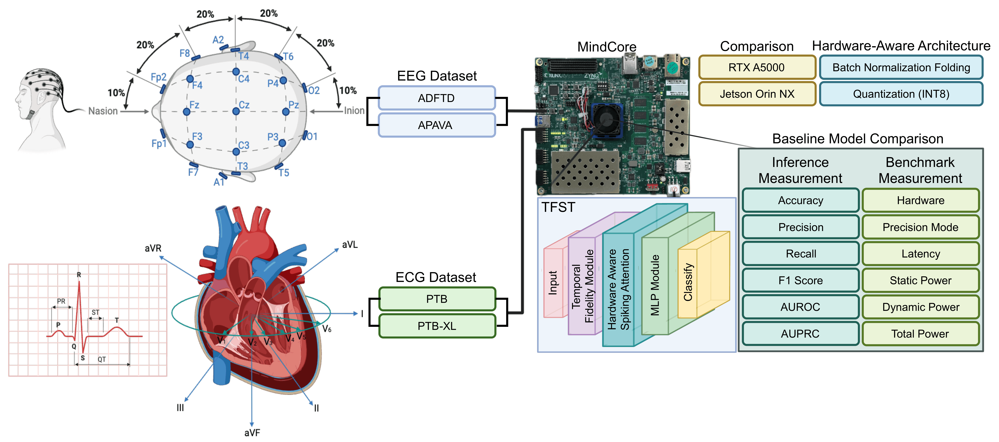
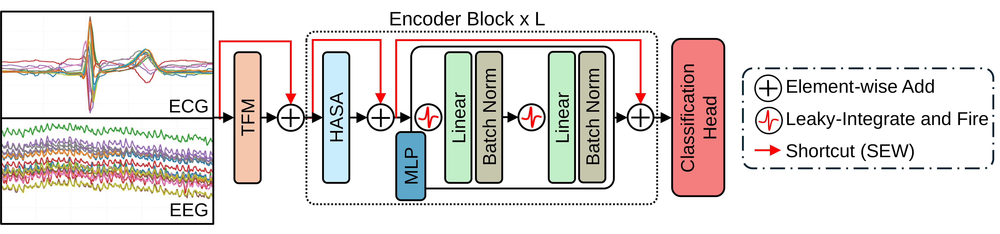
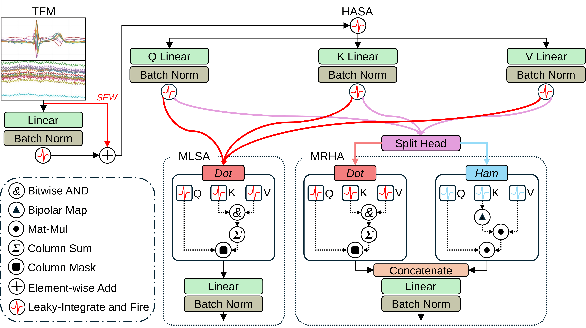

# TFST: Time-Fidelity Spiking Transformer

Reference implementation of TFST, a spiking transformer for biosignal
classification, evaluated on four EEG/ECG benchmarks: **ADFTD**, **APAVA**,
**PTB**, and **PTB-XL**.

<p align="center">
  
</p>
<p align="center"><em>Evaluation pipeline: EEG (ADFTD, APAVA) and ECG (PTB, PTB-XL)
datasets, TFST deployed on the MindCore FPGA, and comparison against RTX A5000
and Jetson Orin NX.</em></p>

The model embeds a multivariate signal with a time-fidelity module, applies a
stack of spiking encoder blocks, and classifies the time-averaged output. Two
spiking attention mechanisms are provided:

| `--attention-type` | Description |
| --- | --- |
| `MLSA` (default) | Masked Logical Spiking Attention. Boolean AND routing between Q, K and V; multiplication-free. |
| `MRHA` | Mixed Routing/Hamming Attention. Half the heads use the boolean route, half use a Hamming-distance route. |

<p align="center">
  
</p>
<p align="center"><em>TFST architecture: the time-fidelity module (TFM) feeds L
spiking encoder blocks (HASA attention + MLP, with SEW shortcuts) and a
classification head.</em></p>

<p align="center">
  
</p>
<p align="center"><em>The time-fidelity module (TFM) and the HASA attention block,
with its two variants: MLSA (AND routing) and MRHA (AND routing on half the heads,
Hamming routing on the other half).</em></p>

## Installation

Requires a CUDA GPU: the `LIFNode` neurons use SpikingJelly's `cupy` backend.

```bash
conda create -n tfst python=3.9 && conda activate tfst
pip install -r requirements.txt
```

`timm` is pinned to 0.6.12 — later releases relocate `timm.models.registry`
and `timm.models.layers`, which this code imports.

## Data

Each dataset is read from a directory holding pre-extracted windows:

```
data/<DATASET>/
├── Feature/       # per-subject .npy windows, shape (N, T, C)
└── Label/label.npy
```

The configs default to `./data/ADFTD`, `./data/APAVA`, `./data/PTB` and
`./data/PTB-XL`. Point them elsewhere with `data_dir` in the YAML or
`-data-dir` on the command line. Splits are made by subject inside each loader
in [data_utils.py](data_utils.py).

| Dataset | Channels | Classes | Time steps |
| --- | --- | --- | --- |
| ADFTD | 19 | 3 | 256 |
| APAVA | 16 | 2 | 256 |
| PTB | 15 | 2 | 300 |
| PTB-XL | 12 | 5 | 250 |

## Usage

Train from a config:

```bash
python train.py -c conf/adftd/TINY_ADFTD_D76-H4-T256-L1_MLP4.yml --model TFS
```

Select the attention mechanism:

```bash
python train.py -c conf/apava/TINY_APAVA_D64-H4-T256-L1_MLP4.yml \
    --model TFS --attention-type MRHA
```

Evaluate a checkpoint without training, optionally reporting FLOPs and
synaptic operations:

```bash
python train.py -c conf/adftd/INFERENCE_ADFTD_D76-H4-T256-L1_MLP4.yml \
    --model TFS --resume /path/to/model_best.pth.tar --FLOPS
```

Checkpoints, logs and `summary.csv` are written under `output/train/<run>/`.

## Configs

`conf/<dataset>/` holds 32 configs named
`[SIZE_]<DATASET>_D<dim>-H<heads>-T<steps>-L<layers>_MLP<ratio>[_DS<n>]`:

- **`TINY` / `MED` / `LARGE`** — model scale. `TINY` is the single-layer model;
  `LARGE` uses 6 layers and a wider embedding.
- **`DS<n>` / `DOWN<n>`** — the time-fidelity ablation. `downsize_factor: n`
  sums every `n` consecutive time steps before the model sees them, so a
  256-step window becomes `256 / n` steps.
- **`INFERENCE`** — evaluation-only variant of the corresponding config.

Note that `embed_dims` must equal `num_heads * in_channels`: the time-fidelity
module fuses the spiking embedding with the raw signal per head.

## Repository layout

```
train.py              training / evaluation entry point
data_utils.py         ADFTD, APAVA, PTB and PTB-XL loaders
model/tfst.py         TFST model, registered with timm as "TFS"
module/tfm.py         TF_Module — time-fidelity signal embedding
module/hasa_mlp.py    spiking attention (MLSA / MRHA) and MLP blocks
conf/                 per-dataset YAML configs
figures/              README figures
```

## Citation

<!-- Replace with the published reference once available. -->

```bibtex
@article{tfst,
  title   = {TODO},
  author  = {TODO},
  journal = {TODO},
  year    = {TODO}
}
```

## License

See [LICENSE](LICENSE).
